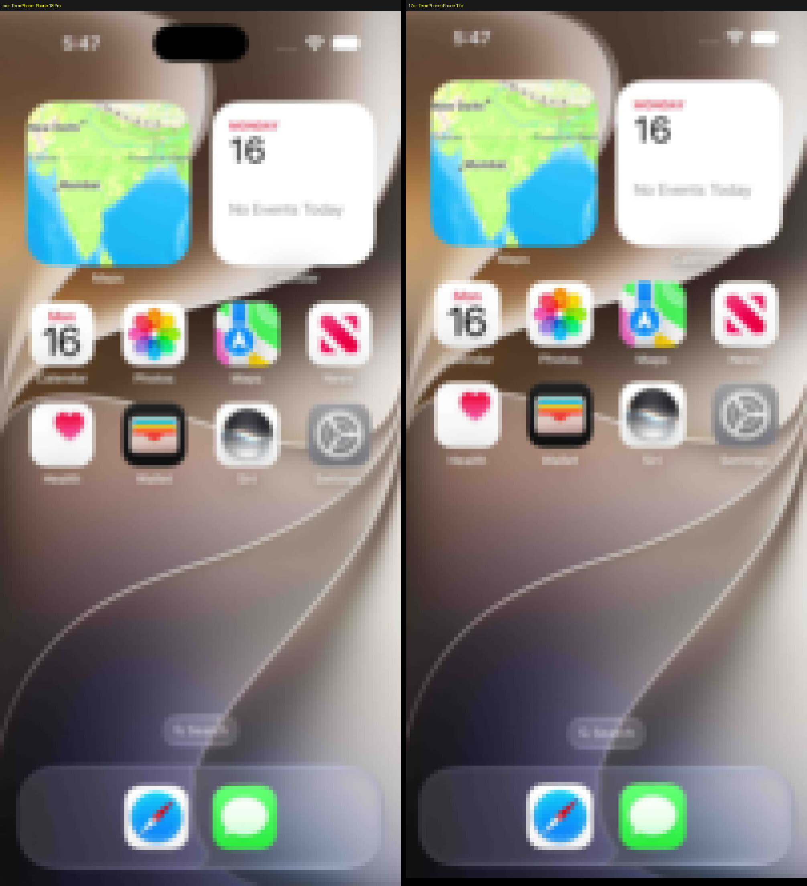
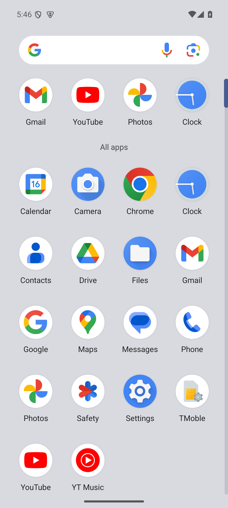

# TermPhone MCP Server

**Let your AI agent see and drive a phone.** TermPhone puts an iPhone (iOS Simulator) and an Android emulator inside your terminal — and its built-in MCP server gives AI agents 20 tools to observe the screen, tap, swipe, type, launch apps, and record flows.

This repository is the public listing & documentation repo for the TermPhone MCP server. TermPhone itself is a paid product (closed source) — get it at **[termphone.com](https://termphone.com)** ($39 one-time, free tier for one device).




## Install

First install TermPhone (macOS for iPhone, macOS/Windows for Android):

```bash
# macOS
curl -fsSL https://termphone.com/install.sh | sh

# Windows (PowerShell)
irm https://termphone.com/install.ps1 | iex
```

Then add the MCP server to your client:

```bash
claude mcp add termphone -- termphone mcp
```

Or in any MCP client's JSON config:

```json
{
  "mcpServers": {
    "termphone": {
      "command": "termphone",
      "args": ["mcp"]
    }
  }
}
```

Transport: stdio. Requires a booted TermPhone session (`termphone up`) — the free tier covers one device.

## Tools

| Tool | Description |
| --- | --- |
| `termphone_sessions` | List configured phone sessions (iOS/Android) and their state |
| `termphone_status` | Status of a session's device |
| `termphone_boot` | Boot a session's simulator/emulator |
| `termphone_shutdown` | Shut a session's device down |
| `termphone_doctor` | Run environment diagnostics |
| `termphone_license` | Show licence status |
| `termphone_observe` | Accessibility tree + screen stamp — act calls refuse to run on a stale screen |
| `termphone_screenshot` | Capture the current screen |
| `termphone_tap` | Tap by accessibility label or coordinates |
| `termphone_swipe` | Swipe / drag gesture |
| `termphone_type` | Type text into the focused field |
| `termphone_home` | Press the Home button |
| `termphone_button` | Press a hardware button |
| `termphone_unlock` | Unlock the device |
| `termphone_launch_app` | Launch an app by bundle id / package name |
| `termphone_terminate_app` | Terminate a running app |
| `termphone_install_app` | Install an app build (.app / .apk) |
| `termphone_record_video` | Record the screen to a video file |
| `termphone_run_script` | Replay a recorded flow |
| `termphone_wait_for` | Wait for an element or text to appear |

## Why it's different

- **Stale-screen guard:** `observe` returns a screen stamp; `act` tools refuse to run if the screen changed since — agents never tap on an outdated frame.
- **Two phones, one terminal:** dual view streams two devices side by side.
- **Built on public infra:** Apple `simctl` + Meta `idb` for iOS; `adb` + the device's own H.264 encoder → ffmpeg for Android (~30 fps in motion).
- **Record & replay** flows, App Store screenshot export, offline Ed25519 licence — no phone-home, no subscription.

## Platform support

- iPhone (iOS Simulator): macOS
- Android (emulator): macOS and Windows
- Simulators/emulators only — no real telephony. A real-device mode is on the roadmap.

## Links

- Product & download: https://termphone.com
- X: https://x.com/Term_Phone
- Licence: TermPhone is proprietary software; this repo's documentation is © Chiranjib Mohanty.
